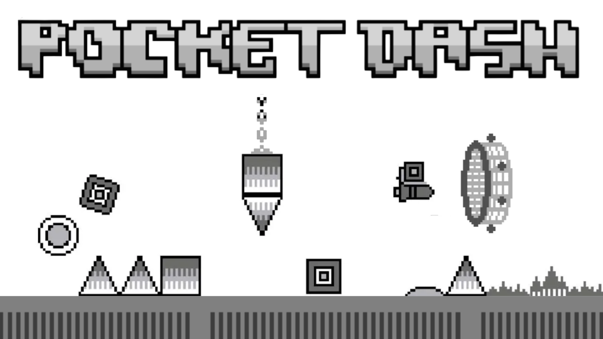

<p align="center">
  
</p>

# Pocket Dash

### Pocket Dash (or Geometry Dash Pocket/GDP) is a demake of Geometry Dash for the DMG and GBC Game Boy!
Info: The project was renamed to Geometry Dash Pocket, and was formerly known as GB DASH

### Images:
<p align="center">
  
  
</p>

<p align="center">
  
  
</p>

<p align="center">
  
  
</p>

<p align="center">
  
</p>

---
# About
Experience the ultimate rage-inducing rhythm platformer, scaled down to 4 shades of green (or gray) and a crisp 160x144 resolution! Built from scratch for original Game Boy hardware.

Unlike GB Dash by TiTi, this one features a Famidash-style gameplay with the actual original levels, and support for the original (DMG) Game Boy!

This game is being actively developed (coding and music) by Sotospro24 and ElAngel378

# Features (as of now)
- All levels up to Xstep, and more Extra Levels
- Gameplay (Cube, Ship, Ball, UFO)
- Accurate Physics
- Collision (Death and block collision)
- Music Covers, played by a Furnace-accurate Game Boy driver ([more info](docs/MUSIC.md))
- Mechanics and objects up to Geometry Dash 1.6, including inverted gravity, mirror mode, fading blocks
- Make your own levels in Tiled ([guide](docs/MAKING_LEVELS.md))
- Level End screen
- Game Boy Original and Color support!

---

# Download 
### Download the latest Nightly build here: <a href="https://github.com/ElAngel378/GBDASH/releases/download/nightly/POCKETDASH.gb"><ins>DOWNLOAD</ins></a>
**WARNING!** These are constantly changing and might be broken.
### Alternatively, download the latest stable build in the releases tab.
---

# Building from source

**Windows:** double-click **`build.bat`**. That's it. It downloads what it needs the first time (Python, Pillow and GBDK 4.5.0, all inside the project's `.tools` folder), and the ROM ends up at `bin/POCKETDASH.gb`.

**Linux and macOS:** run `./build.sh` (only `python3` has to be installed already).

Useful extras:

```
build my_level     builds the game and starts that level in your emulator
build --clean      throws away the temp files and builds everything again
build --jobs 4     compiles fewer files at once, if your computer struggles
```

If you already have GBDK, set the `GBDK` environment variable or keep it in `C:/gbdk` and it will be used instead. Developers can still use `make` (it needs GBDK and GNU Make), after running `python tools/build_levels.py` if the levels changed.

## Making levels

Levels are made in [Tiled](https://www.mapeditor.org). Double-click **`new_level.bat`**, build your level, and press **F5** in Tiled to play it. The full guide, with pictures: **[docs/MAKING_LEVELS.md](docs/MAKING_LEVELS.md)**.

## Music

The game's music is made in [Furnace](https://github.com/tildearrow/furnace) and played by [fur2gb](https://github.com/Soteris24/fur2gb), a Game Boy music driver made for this project. The older songs made in hUGETracker are still in the game and play through [hUGEDriver](https://github.com/SuperDisk/hUGEDriver) when the **LEGACY** setting is on; its prebuilt `lib/hUGEDriver.lib` is included in this repository, so you don't need to install anything extra to build.

How to add songs and how the driver works: **[docs/MUSIC.md](docs/MUSIC.md)**.

---

# Development Info

| Contributor | Contribution |
|---|---|
|[**Sotos_24**](https://github.com/Soteris24) **and** [**ElAngel378**](https://github.com/ElAngel378)|**Project creators and lead developers**|
|[Sotos_24](https://github.com/Soteris24) | Code (main code), Music, Graphics <sub>*when I feel like it*</sub> |
|[ElAngel378](https://github.com/ElAngel378) |Code (optimize), Music, Graphics|
|[Crafty Jumper](https://github.com/Crafty-Jumper) | Music, Graphics |
|[Ziqiangao](https://github.com/ziqiangao/)| Tools, Music, Graphics|
|PBaxx | Graphics |
|Finntendo | Graphics |
|Switchroot | Graphics |
|BobAJoeJoe | Graphics, Music |
|Ranedom | Graphics |
|NerdBoy628 | Music |
|UserSniper | Music |
|Claude (LLM) | Code, NO music or graphics |

**Music credits:** which song was made by whom is listed in [docs/MUSIC.md](docs/MUSIC.md#music-credits).


---

# TODO
- Electroman Adventures and Clubstep as their 1.6 versions
- The rest of the 1.6 sprite objects
- Graphical improvements

---

# Contributing 

**Ways of Contributing**
1. Join the [Discord](https://discord.gg/cg8NRGxJTv)
2. Pull Requests
3. Contacting the main devs
4. Do NOT open issues for a discussion.
5. Any issues can be reported in the issues tab.

# Thank you
### To <a href="https://github.com/tfdsoft/famidash"><ins>TFDSoft</ins></a> , the Famidash team for assets (such as level files, graphics)
### And, of course, the game we all love: Geometry Dash by RobTop Games.
### AI Disclosure

AI tools (LLMs) are used in this project. Up to release 0.3 they were only used for things like boilerplate code, optimizing parts of the code and brainstorming solutions.

After release 0.3 there is some vibecoding. Development is much faster that way, and as I have school and other things going on, it lets me keep working on the game while focusing on my studies. It also generally makes the whole process easier, and in my experience it leads to fewer bugs and optimizes very well.

Developing for the original 1989 Game Boy with GBDK 2020 still requires a solid understanding of things like memory management, bank switching, hardware registers and low-level C/Assembly optimization, so the direction, decisions, testing and debugging are still done by us.
