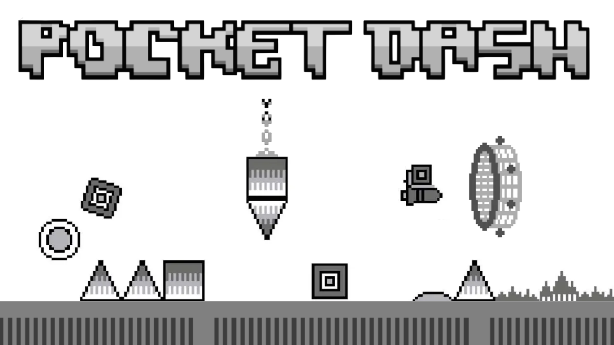

<p align="center">
  
</p>

# Pocket Dash

### Pocket Dash (or Geometry Dash Pocket/GDP) is a demake of Geometry Dash for the DMG and GBC Game Boy!
Info: The project was renamed to Geometry Dash Pocket, and was formerly known as GB DASH

### Images:
<p align="center">
  
  
</p>

<p align="center">
  
  
</p>

<p align="center">
  
  
</p>

<p align="center">
  
</p>

---
# About
Experience the ultimate rage-inducing rhythm platformer, scaled down to 4 shades of green (or gray) and a crisp 160x144 resolution! Built from scratch for original Game Boy hardware.

Unlike GB Dash by TiTi, this one features a Famidash-style gameplay with the actual original levels, and support for the original (DMG) Game Boy!

This game is being actively developed (coding and music) by Sotospro24 and ElAngel378

# Features (as of now)
- All levels up to Xstep
- Gameplay (Cube, Ship, Ball)
- Accurate Physics
- Collision (Death and block collision)
- Music Covers, played by a Furnace-accurate Game Boy driver ([more info](docs/MUSIC.md))
- All 1.0 - 1.2 mechanics including inverted gravity, mirror mode
- Level End screen
- Game Boy Original and Color support!

---

# Download 
### Download the latest Nightly build here: <a href="https://github.com/ElAngel378/GBDASH/releases/download/nightly/POCKETDASH.gb"><ins>DOWNLOAD</ins></a>
**WARNING!** These are constantly changing and might be broken.
### Alternatively, download the latest stable build in the releases tab.
---

# Building from source

Requires **GBDK-2020** (`gbdk-2020` v4.2.x or newer) and GNU Make.

- **Windows:** download the latest [GBDK releases](https://github.com/gbdk-2020/gbdk-2020/releases), unzip it, and point the build at it. The default search path is `C:/gbdk`; override it with the `GBDK` variable (e.g. `make GBDK=C:/dev/gbdk-2020`).
- **Linux/macOS** (and GitHub Actions): fetch and extract the `gbdk-linux64` release from the [GBDK releases](https://github.com/gbdk-2020/gbdk-2020/releases), then run `make` with `GBDK=/path/to/gbdk` exported.

Build the ROM:

```
make clean
make -j8
```

The output is `bin/POCKETDASH.gb`.

## Music

The game's music is made in [Furnace](https://github.com/tildearrow/furnace) and played by [fur2gb](https://github.com/Soteris24/fur2gb), a Game Boy music driver made for this project. The older songs made in hUGETracker are still in the game and play through [hUGEDriver](https://github.com/SuperDisk/hUGEDriver) when the **LEGACY** setting is on; its prebuilt `lib/hUGEDriver.lib` is included in this repository, so you don't need to install anything extra to build.

How to add songs and how the driver works: **[docs/MUSIC.md](docs/MUSIC.md)**.

## Making levels

Levels are made in [Tiled](https://www.mapeditor.org/), with Pocket Dash's own object and sprite tilesets (1.5 and 1.6 blocks, slabs, saws, breakable blocks, portals, orbs, pads...).

How to make a level, from an empty map to playing it: **[docs/LEVEL_BUILDING_GUIDE.md](docs/LEVEL_BUILDING_GUIDE.md)**. Adding new objects: [levels/objects/README.md](levels/objects/README.md).

---

# Development Info

| Contributor | Contribution |
|---|---|
|[**Sotos_24**](https://github.com/Soteris24) **and** [**ElAngel378**](https://github.com/ElAngel378)|**Project creators and lead developers**|
|[Sotos_24](https://github.com/Soteris24) | Code (main code), Music, Graphics <sub>*when I feel like it*</sub> |
|[ElAngel378](https://github.com/ElAngel378) |Code (optimize), Music, Graphics|
|[Crafty Jumper](https://github.com/Crafty-Jumper) | Music, Graphics |
|[Ziqiangao](https://github.com/ziqiangao/)| Tools, Music, Graphics|
|PBaxx | Graphics |
|Finntendo | Graphics |
|Switchroot | Graphics |
|BobAJoeJoe | Graphics, Music |
|Ranedom | Graphics |
|NerdBoy628 | Music |
|UserSniper | Music |

**Music credits:** which song was made by whom is listed in [docs/MUSIC.md](docs/MUSIC.md#music-credits).


---

# TODO (for 1.0 release)
- Add all objects, mechanics, levels up to 1.5
- A proper menu and level select
- Decoration (supported only in GBC mode)
- Graphical improvements

---

# Contributing 

**Ways of Contributing**
1. Join the [Discord](https://discord.gg/cg8NRGxJTv)
2. Pull Requests
3. Contacting the main devs
4. Do NOT open issues for a discussion.
5. Any issues can be reported in the issues tab.

# Thank you
### To <a href="https://github.com/tfdsoft/famidash"><ins>TFDSoft</ins></a> , the Famidash team for assets (such as level files, graphics)
### And, of course, the game we all love: Geometry Dash by RobTop Games.
### AI Disclosure

AI tools (LLMs) are used in this project. Up to release 0.3 they were only used for things like boilerplate code, optimizing parts of the code and brainstorming solutions.

After release 0.3 there is some vibecoding. Development is much faster that way, and as I have school and other things going on, it lets me keep working on the game while focusing on my studies. It also generally makes the whole process easier, and in my experience it leads to fewer bugs and optimizes very well.

Developing for the original 1989 Game Boy with GBDK 2020 still requires a solid understanding of things like memory management, bank switching, hardware registers and low-level C/Assembly optimization, so the direction, decisions, testing and debugging are still done by us.
