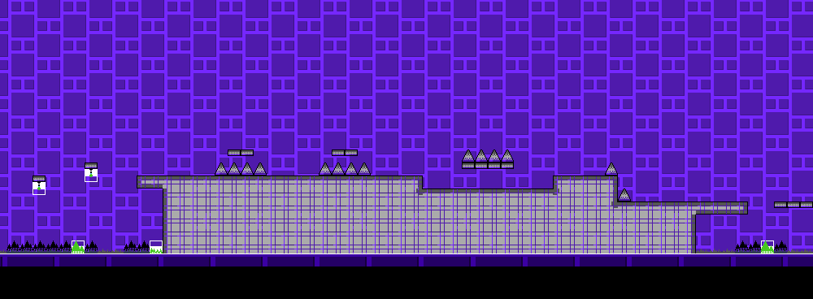
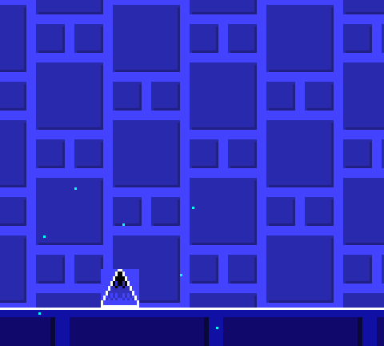

# Making a level

You need two things: this project's folder, and [Tiled](https://www.mapeditor.org) (a free map editor). Everything else (Python, the Game Boy compiler) downloads itself the first time and stays inside the project's `.tools` folder. Nothing gets installed on your computer.

These steps are for Windows. On Linux or macOS, see [the note at the end](#linux-and-macos).

## 1. Create your level

Double-click **`new_level.bat`**. It asks for two things:

- A **file name**: letters, numbers and `_` only, like `my_level2`. It can't end in `_` and a number.
- A **title**: what the game shows, up to 18 letters and numbers.

Your level opens in Tiled, saved as `levels/chr_data/tmx/my_level.tmx`.

The first run downloads Python, so give it a minute.

## 2. Build it



The grid is 16 px per block, like one block in Geometry Dash. In Tiled, pick an object from the **Tilesets** panel and click on the map.

| Do this | How |
|---|---|
| Rotate or flip an object | `Z` rotates, `X` and `Y` flip |
| Make the level longer | Map > Resize Map, then change **Width**. Keep the height: 30 |
| Stack objects | Use `Layer 2` or `Layer 3`, they draw on top of `Layer 1` |
| Place half a block off the grid | Use a layer named `+8x`, `+8y` or `+8x +8y` |

The bottom 3 rows are below the floor, so you only see what hangs into them from the rows above.

### Portals, pads, orbs, coins, triggers

These go on the **SP** layer, and they come from the **sprites** tileset. On this layer you can drop them anywhere, not just on the grid. Select the SP layer first, then press `T` (Insert Tile) and click.

Your level ends at its last column by itself. To end it sooner, place a **Level end** object.

### Colours

**Map > Map Properties** has your level's settings:

| Property | What it does |
|---|---|
| `Title` | The name in the game's list: up to 18 letters and numbers (21 on the Main menu) |
| `Menu` | `Main` is the PLAY menu, `Extra` is the wrench menu |
| `Order` | Its place in that menu: lower numbers come first |
| `Song` | The song it plays, by file name. `none` means silence |
| `Save slot` | Where its progress and coins are saved. It's filled in for you, leave it alone |
| `BG colour` | The sky's colour at the start |
| `Ground colour` | The ground's colour at the start |
| `Max fall` | How fast the cube falls: 6 for most levels, 7 for the later ones |

To change colour during the level, place a **BG colour**, **Ground colour** or **Outline colour** trigger on the SP layer, then set its **Colour** and **Fade** in the Properties panel. The game picks the closest colour it can show.

### The sky and ground in Tiled

The sky and the ground behind your level are only a preview. They aren't part of the level and you can't edit them. They follow your colours and triggers: **press F6** to redraw them. If the picture doesn't change, press `Ctrl+R` to reload.

## 3. Play it

**Press F5 in Tiled.** It saves, builds the game and starts your level straight away. The first build takes a few minutes, and after that about half a minute.

> **Does F5 do nothing?** Tiled needs the project open, not just the level. Double-clicking a `.tmx` file doesn't open the project. See [Coming back to your level](#coming-back-to-your-level).

To open it automatically, your computer needs a Game Boy emulator set as the program for `.gb` files. Otherwise, open `bin/POCKETDASH_test.gb` yourself, in any emulator.



In the full game (`bin/POCKETDASH.gb`), your level is in the **Extra Levels** list: the wrench on the main menu. Community levels don't save your best percentage or coins.

## Coming back to your level

Start Tiled, choose **File > Open File or Project**, and pick `levels/chr_data/pocket_dash.tiled-project`. Your levels are in the **Project** panel, in the `tmx` folder. Tiled remembers the project the next time you start it.

Don't double-click a `.tmx` file to open it. Tiled then opens only the map, without the project, so F5, F6 and the dropdown lists in Map Properties won't work.

## If something goes wrong

Build errors are written in plain words, and they say what to change. The common ones:

| The message says | What to do |
|---|---|
| Too many different combinations of objects | Each spot where objects overlap counts as a combination, and a level can have about 200. Reuse the same blocks, or stack less. The message says which column it reached |
| A tile isn't one of the game's objects | You used a sprite on a tile layer, or a block on the SP layer |
| The game no longer fits in the ROM | The level is very long, or there are too many levels |

Still stuck? Ask on the [Discord](https://discord.gg/cg8NRGxJTv) and attach **`build_error.log`** from the project's folder.

To start over from nothing, delete the `temp` folder (or run `build --clean`). To also re-download the tools, delete `.tools`.

## Your own song

Put a Furnace song with any name in `music/Furnace/` and build once. It then shows up in the `Song` list in Tiled, and any level can pick it. On Windows the song converter downloads itself the first time, and a new song can take a few minutes. More in [MUSIC.md](MUSIC.md).

## Linux and macOS

You need `python3`, and Tiled from your package manager or its website. Then, from the project's folder:

```
./build.sh new my_level "My Level"
./build.sh my_level
```

F5 and F6 in Tiled are Windows only, so run `./build.sh my_level` to play. The sky and ground update on every build.
